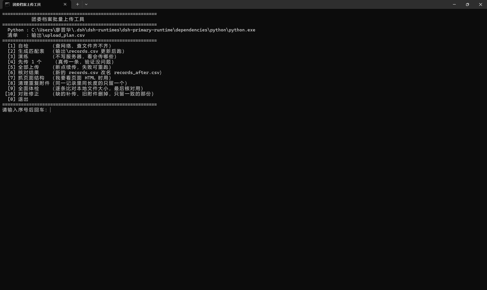
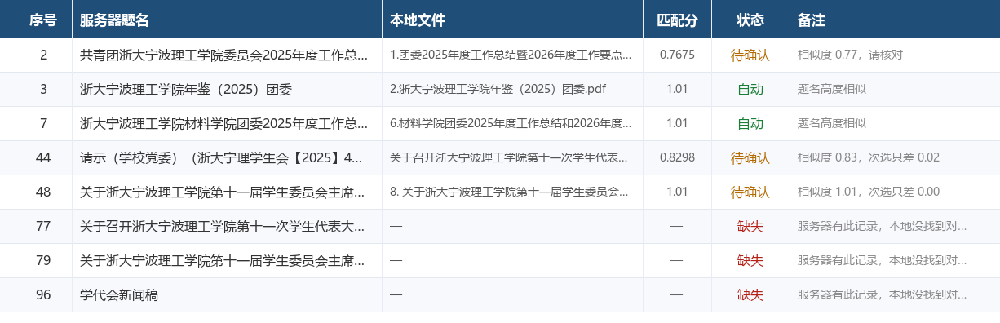
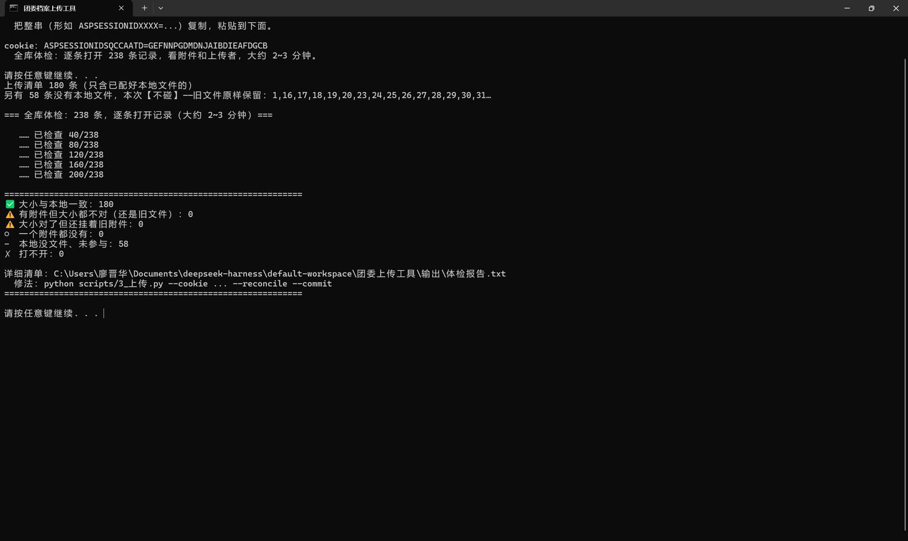
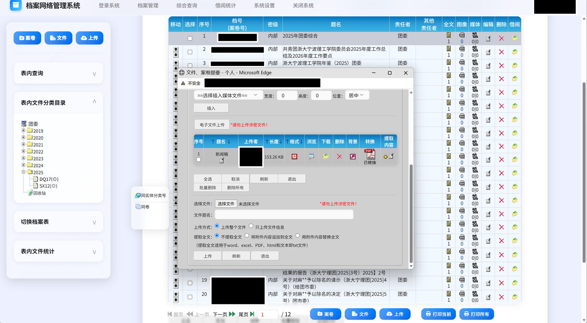

# 档案系统批量上传工具

给老式 ASP 档案管理系统（南大之星之类）做**批量附件上传 + 旧文件清理**的一套小工具。

> **Batch attachment uploader for legacy ASP archive systems.**
> Many Chinese university archives still run on classic ASP systems with no API —
> every file must be uploaded and the old one deleted by hand, one record at a time.
> This tool turns a 238-record job into `export → match → dry-run → run → audit`.
> Pure Python standard library, **zero dependencies**. Chinese docs only for now.

校园档案馆/团委每年要往系统里补几百个文件。系统只提供"一条记录 → 点上传 → 选文件 → 填题名 → 上传 → 再删掉旧文件"的网页操作，几百条就是几百遍。这套工具把这件事变成：

```
导出清单 → 自动配对 → 演练 → 一条试传 → 全量跑完 → 体检
```

全程 Python 标准库，**零第三方依赖**，不用 pip install 任何东西。

> 实战战绩：某高校团委 238 条记录、277 个本地文件，最终 180 条按字节大小核对一致，
> 0 条错位、0 条重复、0 条残留旧附件。


<p align="center">
  <br>
  <sub>双击 <code>开始.bat</code> 就有菜单，不用敲任何命令</sub>
</p>

| 配对表（`upload_plan.csv`） | 全库体检 |
|---|---|
|  |  |
| 按真实数据渲染：哪条能自动传、哪条要人看 | 逐条按字节核对，给出六类结论 |

<p align="center">
  <br>
  <sub>目标系统就是这种老式 ASP 页面：一条记录一张附件表，只能手点</sub>
</p>

---

## ⚠️ 使用前必读

> **本工具仅用于提高办公效率。使用者需自行保证上传文件的准确性、合法性，
> 并确认自己对目标系统有操作授权。**
>
> 因使用本脚本导致的**数据丢失、系统异常、违规操作或由此引发的任何纠纷，
> 作者及贡献者不承担任何责任**。
>
> 脚本会**真实写入**目标系统（上传附件、删除附件），且**不可撤销**。
> 请务必先备份、先演练、先单条验收，再全量执行。
> 涉密文件请勿上传——系统页面上通常就写着那几个红字。

---

## 目录

* [⚠️ 使用前必读](#️-使用前必读)
* [零基础安装（没装过 Python 也能跑）](#零基础安装没装过-python-也能跑)
* [它解决的不是"上传"，是"对号"](#它解决的不是上传是对号)
* [适用 / 不适用](#适用--不适用)
* [快速开始](#快速开始)
* [工作原理](#工作原理)
* [踩过的坑（重要）](#踩过的坑重要)
* [目录结构](#目录结构)
* [常见问题](#常见问题)
* [已知限制](#已知限制)
* [贡献](#贡献)
* [变更记录](#变更记录)
* [安全与免责](#安全与免责)
* [致谢](#致谢)

---

## 零基础安装（没装过 Python 也能跑）

这一节是给"只会用 Office、没写过代码"的同学写的。熟手可以直接跳到[快速开始](#快速开始)。

### 第 1 步：装 Python（只需一次）

1. 打开 [https://www.python.org/downloads/](https://www.python.org/downloads/)，点黄色按钮下载 Windows 安装包
2. 双击安装，**第一屏务必勾选 `Add python.exe to PATH`**（这一项不勾，后面一定报错）
3. 再点 `Install Now`，等它装完

> 本项目**不需要** `pip install` 任何东西——所有功能只用 Python 自带的库。
> 你也**不需要**装 Git、Node.js、Visual Studio 之类的东西。

### 第 2 步：验证装好了

按 `Win + R`，输入 `cmd` 回车，在黑窗口里敲：

```
python --version
```

能看到 `Python 3.x.x` 就成功了。

如果提示 **"不是内部或外部命令"** 或 **"系统找不到指定的路径"**：

* 说明装的时候没勾 PATH。最省事的办法是**重装一遍并勾上**；
* 或者在本目录**新建一个文本文件** `python路径.txt`，里面**只写一行**解释器的完整路径：

```
  C:\Users\你的用户名\AppData\Local\Programs\Python\Python312\python.exe
  ```

（`开始.bat` 会优先读这个文件；不知道路径就先在文件资源管理器里搜 `python.exe`）

### 第 3 步：改配置

用记事本打开 `config.example.json`，改完另存为 **`config.json`**（放在同一个目录）。

最少要改 3 个：

* `base_url` —— 你们档案系统的地址，只写到端口为止，例如 `http://10.0.0.1`
* `local_root` —— 你电脑上放档案 PDF 的根目录，**反斜杠要写两个**：`C:\Users\你\Desktop\档案`
* `old_uploader` / `me` —— 要删掉谁的旧附件、你自己在系统里显示的名字

### 第 4 步：双击 `开始.bat`

出来一个数字菜单，照着[快速开始](#快速开始)的顺序按就行。**不用敲任何命令。**

### 遇到报错怎么办

1. 黑窗口**别关**，把里面红色的字或整个窗口截图
2. 连同一句"我按了第几步"一起发给会用 AI 的同学（或者直接发给 AI），90% 能当场定位
3. 所有输出同时写在 `输出\\运行日志.txt` 里，发这个文件比截图更准

最常见的三个错：

|报错|原因|怎么办|
|-|-|-|
|`连接超时` / `WinError 10060`|没连内网 / VPN|先连校园网，跑菜单 `[1]` 自检|
|`会话失效（跳到登录页）`|cookie 过期了|回浏览器重新取一次 cookie|
|`❌ 页面结构和预期不符`|系统模板不一样|跑菜单 `[7]` 把页面存下来，找人适配|

---

## 它解决的不是"上传"，是"对号"

批量上传本身不难，难的是**搞清楚哪个文件该传到哪条记录**。实际档案整理里的坑：

* 文件名的序号和服务器序号**并不等价**（中间会插入别的记录，一个不对齐后面全错位）
* 服务器上有**重复的档号**，按档号去重会悄悄吞掉记录
* 有几条记录**本地根本没有对应文件**，不能瞎传，更不能把旧文件删了
* 有些记录**已经人工传过了**，再传一遍就变成重复附件

这套工具的核心是第 2 步的**题名相似度配对**，以及每一步的"宁可停下也不做错"。

---

## 适用 / 不适用

**适用**

* 制度要求"新文件必须覆盖旧文件，且要删掉前任上传的那份"
* 服务器记录有规范题名，本地文件命名与之大体一致（不必完全相同）
* 几百条量级，人工能核，但不能手点

**不适用**

* 目标系统有正式 API（直接用 API，别爬页面）
* 需要处理成千上万条（应该直接写库）
* 附件是扫描件且题名完全无规律（这种情况 OCR 或人工都更靠谱）

---

## 快速开始

### 0\. 准备

|需要|说明|
|-|-|
|操作系统|Windows（`开始.bat` 菜单基于 cmd）；Python 脚本本身跨平台|
|Python|**3.8 及以上**，`python --version` 能出版本号即可|
|依赖|**无**。不装 pip 包，不需要虚拟环境|
|浏览器|Edge / Chrome（用来登录系统、跑导出脚本、取 cookie）|
|网络|能访问目标系统的内网/VPN|
|磁盘|输出目录几百 KB，本地文件本身多大都行|

> Windows 上的一个坑：Microsoft Store 的 `python` 有时是个空壳（运行时提示"找不到指定的路径"）。
> 用 `where python` 确认路径，或在 `python路径.txt` 里写死解释器绝对路径。

把 `config.example.json` 复制成 `config.json`，改成你自己的：

```json
{
  "base_url": "http://10.0.0.1",
  "local_root": "C:\Users\你的用户名\Desktop\档案",
  "old_uploader": "范芸",
  "me": "刘笑成",
  "id_base": 0,
  "record_total": 238,
  "exclude_dirs": ["学代会照片"],
  "stop_words": ["某某大学"]
}
```

|字段|含义|
|-|-|
|`base_url`|档案系统地址（**不要带 `/file/...` 那部分**）|
|`local_root`|本地档案根目录|
|`old_uploader`|旧附件的上传者名字，传完新文件后要删掉他的|
|`me`|你自己的上传者名字，用来判断"这条是不是已经传过了"|
|`id_base`|记录 id 是否连续。0 = 用导出清单里的真实 id（推荐）|
|`record_total`|这个案卷一共多少条记录，只用于"缺哪些序号"的提示|
|`exclude_dirs`|不参与上传的目录名（照片、草稿等）|
|`stop_words`|配对时要去掉的学校专名（提高相似度判别的准确率）|

### 1\. 导出服务器清单（浏览器里，只读）

登录系统，打开记录列表页 → `F12` → 控制台 → 粘贴 `scripts/1_导出服务器清单.js` → 回车。

脚本会自动翻页，最后下载 `records.csv`（序号 / 档号 / 题名 / 文件id / 全文数）。

> 翻页翻不动没关系：手动点"下一页"再跑一次，结果存在浏览器里自动合并，不重复不覆盖。
> 想清空重来：控制台里执行 `清空导出()`。

把 `records.csv` 放进 `输出/`。

### 2\. 生成配对表

```bash
python scripts/2_生成匹配表.py --records "输出/records.csv"
```

产出三份：

* `输出/upload_plan.csv` —— **要人工过一遍的表**：服务器题名、对应本地文件、相似度、状态
* `输出/本地清单.csv` —— 本地所有文件
* `输出/匹配报告.md` —— 待确认项、服务器有但本地没文件的、本地多出来的

`状态` 三档：`自动`（可直接传）/ `待确认`（看一眼）/ `缺失`（本地没文件，不碰）。

要改就改 `本地文件` 这一列，或在 `输出/手动指定.csv` 里写死：

```csv
序号,本地文件
12,学代会\\新闻稿.pdf
96,
```

（留空 = 这条不上传、也不删它的旧文件。手动指定优先级最高，重跑也不会被覆盖。）

### 3\. 演练 → 单条 → 全量

```bash
# 只检查页面结构，不传
python scripts/3_上传.py --cookie "ASPSESSIONIDxxx=..." --probe

# 演练 5 条（一个文件都不传）
python scripts/3_上传.py --cookie "..." --limit 5

# 真传 1 条，去网页上验收
python scripts/3_上传.py --cookie "..." --limit 1 --commit

# 全量（断点续传，已成功的自动跳过）
python scripts/3_上传.py --cookie "..." --commit
```

`cookie` 在浏览器控制台执行 `document.cookie` 打印，整串复制。

Windows 用户可以直接双击 `开始.bat`，菜单操作，不用记命令：

|菜单|作用|
|-|-|
|1 自检 / 2 生成匹配表 / 3 演练 / 4 传一条 / 5 全量|主流程|
|6 核对 / 7 抓页面结构|辅助|
|8 清理重复附件 / 9 全面体检 / 10 对账修正|收尾|

### 4\. 体检与对账（收尾核对）

```bash
# 体检：逐条比对「本地文件大小」和「线上附件大小」
python scripts/3_上传.py --cookie "..." --audit

# 对账修正：缺的补传、大小不符的旧附件删掉
python scripts/3_上传.py --cookie "..." --reconcile          # 先只报告
python scripts/3_上传.py --cookie "..." --reconcile --commit # 确认后执行
```

体检报告把每条记录分成六类，写进 `输出/体检报告.txt`：

|分类|含义|要不要处理|
|-|-|-|
|✅ 大小与本地一致|挂的就是你要的那份|不用|
|⚠️ 大小都不对|有附件，但都不是本地这份（旧版本）|要，`--reconcile` 会补传|
|⚠️ 大小对了但还挂着旧附件|新的传上去了，旧的没删干净|要，`--reconcile` 会删旧的|
|○ 一个附件都没有|空记录|看情况|
|- 本地没文件|本来就不参与|不用|
|✗ 打不开|网络/权限问题|排查|

**判据只有「文件大小」，不看上传者名字**——同一个账号会反复上传，按名字分新旧一定会错（见下面的坑）。`--kb-tol` 可调容差（默认 1 KB）。

---

## 工作原理

```
浏览器导出 ──► 题名配对 ──► 构造 multipart ──► 逐条上传 ──► 回读校验 ──► 删旧文件
   (JS)          (py)           (py)              (py)         (py)          (py)
```

### 关键设计一：靠题名配，不靠编号

`2_生成匹配表.py` 的相似度：

```
0.45 × difflib 序列相似度  +  0.55 × 字符 bigram Jaccard
（一方包含另一方时 +0.18 加分）
```

归一化时**保留数字**——因为 `例会提要【2025.5.23】` 和 `【2025.9.16】` 去掉数字就完全一样了，六份文件会互相抢位置。

### 关键设计二：四道拦停闸门

|闸门|触发条件|动作|
|-|-|-|
|表单结构自检|找不到 file 控件 / 题名字段 / 「上传整个文件」单选|立刻停，一个都不传|
|档号核对|打开页面上的档号和清单里这条对不上|立刻停（说明 id 错位，会传到别人头上）|
|已处理跳过|记录里已有**大小与本地一致**的附件|跳过，不重复传|
|连续失败熔断|连续 3 条失败|停下（多半是 cookie 过期或没连内网）|

### 关键设计三：先传后删，看不到新文件就不删

删旧文件是不可逆的。所以顺序固定：上传 → 重新取页面 → 确认新文件确实在 → 才发删除请求。任何一步对不上，宁可不删，打印提示让人工处理。

---

## 踩过的坑（重要）

这些是实际跑一遍才会遇到的，写下来省得后人重踩：

|现象|真实原因|处理|
|-|-|-|
|导出的记录少一条|两条记录**档号相同**，按档号去重把其中一条吞了|改用「序号」当唯一键|
|整段错位|目录名里的 `65-70` 是**文件编号**，不是服务器序号，两者差 N|放弃编号推算，改题名匹配|
|id 推算对不上|记录 id 不是连续的，**别的案卷的记录插在中间**|从列表页复选框取真实 id|
|打开页面 404|端口从 `:800` 换成 `:80`，参数从 `od=` 换成 `op=edit`|以浏览器地址栏为准|
|附件表解析出 0 行|表格的 `<tr>/<td>` **不闭合**，且表头含排序箭头（`↑ 题名 ↓`）|按 `class=mtbtl` 每 11 个单元格切行，表头去非汉字|
|传上去中文乱码|页面是 **GBK** 编码，multipart 里按 UTF-8 编了|文本字段和文件名都按页面 charset 编码|
|同一个文件传了两遍|判重靠"题名包含"，两份题名措辞不同就漏判|改用文件大小比对|
|大小明明一致却判成不符|超过 1 MB 后页面只显示两位小数（`1.11 MB`），真实精度是 ±5 KB|容差按显示精度自动放大，不要写死 1 KB|
|**以为"上传者是我就算新的"**|同一账号几个月前也传过一轮，名字对了但**内容不是最新版**；页面上根本看不出新旧|**只认文件大小**，并在体检里逐条对账|

> 最后一条是最贵的教训：`上传者 = 我` 不等于 `文件 = 我要的那份`。
> 这套工具最早按"上传者"判断处理状态，跑完全绿，抽查一条才发现大小不对——旧版本的 PDF 还挂在那儿。
> 现在唯一可靠的判据是：**线上附件大小 == 本地文件大小**。抓不到大小就别下结论。

---

## 目录结构

```
tools/archive-uploader/
├─ 开始.bat              Windows 双击菜单（1~10）
├─ config.example.json   配置模板 → 复制成 config.json
├─ README.md             你正在看的这份（详细说明）
├─ DeepSeek.md           这个工具是怎么被做出来的（过程记录）
├─ scripts/
│   ├─ 0_自检.py          开工前：网络 / 文件 / 待确认数量
│   ├─ 1_导出服务器清单.js 浏览器控制台粘贴，导出 records.csv
│   ├─ 2_生成匹配表.py     题名配对，产出 upload_plan.csv
│   ├─ 3_上传.py          演练 / 单条 / 全量 / 清理重复 / 全库体检 / 对账修正
│   ├─ 4_核对.py          上传后按清单核对
│   ├─ conf.py            统一读 config.json
│   └─ runlog.py          输出同时写日志
├─ docs/                 截图
├─ 样例/                 用真实数据脱敏后的样例，可先跑通流程
└─ 输出/                 所有产物（已 gitignore）
```

> 整个文件夹可以单独拷走使用，不依赖仓库里的其他东西。

---

## 常见问题

**Q：能不能不装 Python？**
不能。所有逻辑都在 Python 里（虽然只用标准库）。但不需要 pip，任何 3.8+ 解释器都行。

**Q：换了系统 / 换了页面，还能用吗？**
上传部分靠解析表单结构（找 `type=file`、找"文件题名"后面的输入框、"上传整个文件"单选）。如果对方系统模板不同，`--probe` 会明确告诉你哪一项没找到，而不是瞎传。适配通常只要改 `parse_form()` 和 `find_attachments()` 两个函数。

**Q：会不会把文件传到错的记录上？**
每打开一条记录都会核对档号，对不上立即停。演练模式下不会写任何数据。

**Q：能撤销吗？**
不能。上传和删除都是真实操作。所以流程强制"演练 → 单条 → 全量"。真要重来，只能人工在系统里删。

**Q：cookie 多久过期？**
ASP 会话一般 20 分钟无操作就失效。失效时脚本会打印"会话失效"并停下，重跑会接着上次进度（成功记录在 `输出/upload_log.jsonl`）。

---

## 已知限制

用之前先看这几条，能省很多时间：

1. **只认这一种附件表结构**。解析靠 `class=mtbtl` 的单元格每 11 个一组切行。
换个模板的系统，`find_attachments()` 要重写——但 `--audit` 会先把"解析到 0 个附件"暴露出来。
2. **删旧附件是"一条记录保留一个附件"的假设**。如果你的业务允许一条记录挂多个不同文件，
`--reconcile` 会误删——这种情况请加 `--no-delete`，只传不删。
3. **单线程、串行**。238 条约 5~8 分钟。为了不把老服务器打垮，这是故意的；有 `--sleep` 可调。
4. **cookie 要手工取**，没有自动登录。ASP 会话约 20 分钟无操作失效，脚本会停下而不是死循环。
5. **不能撤销**。上传和删除都是真实写入，系统没有事务、没有回收站。
6. **配对靠题名相似度，不是语义理解**。同名、同题不同文、题名与文件名完全无关的，
一律会落到「待确认」，需要人工在 `upload_plan.csv` 里定。工具不替人猜。

---

## 贡献

欢迎提 issue / PR，尤其是这两类：

* **适配了别的档案系统**：把 `parse_form()` / `find_attachments()` 的改法和一份脱敏页面 HTML 一起提上来，很有参考价值。
* **新的坑**：如果踩到 README 踩坑表里没有的，直接补一行，比写代码更有用。

提交前请确认：

```bash
python -m py_compile scripts/*.py
node --check scripts/1_导出服务器清单.js
```

**不要把 `config.json`（含真实 IP、姓名）和 `输出/` 的真实数据提上来。**

---

## 变更记录

### v1.0

* 首次发布：导出清单、题名配对、演练/单条/全量上传、断点续传、重复附件清理、全库体检、对账修正
* 判据从"上传者"改为"文件大小"（含 MB 显示精度补偿）
* Windows 双击菜单（`开始.bat`，1~10）

---

## 安全与免责

* 本工具面向**你有权限操作**的档案系统。请确认你的账号有授权，并遵守所在单位的信息安全规定。
* 上传前请自行确认文件**不涉密**——系统页面上通常就写着那句红字。
* 删除旧附件是不可逆操作，脚本只在确认新文件已到位时才执行。
* 生产数据请先备份。作者不对误操作导致的数据损失负责。

### 敏感信息怎么处理

|信息|存在哪|会不会进仓库|
|-|-|-|
|服务器地址、姓名、目录|`config.json`|❌ 已被 `.gitignore` 排除|
|登录 cookie|**不存盘**，每次运行时输入|❌ 只在内存里|
|运行产物（清单/日志/体检报告）|`输出/`|❌ 已被 `.gitignore` 排除|

`config.example.json` 是给别人的模板，里面只有占位符。**提交前请跑一次 `git status`，确认没把 `config.json` 和 `输出/` 加进去。**

> 小提醒：用命令行传 `--cookie "..."` 时，某些终端会把它记进历史记录。
> 用 `开始.bat` 菜单则不会——它是交互式输入的。

## 致谢

* 这个工具是在一次真实的档案整理任务中长出来的：238 条记录、277 个本地文件、
两次判断失误、一次差点交差的假"全绿"。过程记录在 [DeepSeek.md](DeepSeek.md)。
* 代码由 **DeepSeek Harness** 生成，需求、业务规则、判断依据和每一次"这里不对"都由使用者提出。
* 感谢所有在 issue 里补充"我踩到的坑"的人。

> *Code generated with DeepSeek Harness, prompted by 廖晋华.*

## 许可

[MIT](../../LICENSE) —— 随便用、改也行，但不承担任何责任。

